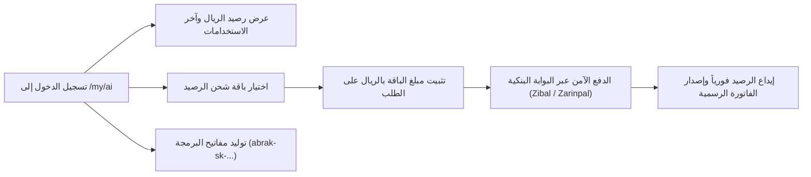

<div align="right" dir="rtl">

# دليل شحن محفظة الذكاء الاصطناعي الشخصية (`/my/ai`)

**[فارسی](../fa/ai-wallet.md) · [English](../en/ai-wallet.md) · [العربية](ai-wallet.md) · [پښتو](../ps/ai-wallet.md)**

في منظومة أبرك (Abrak) السحابية، يتم تشغيل نماذج الذكاء الاصطناعي المتقدمة (سواء عبر واجهة المحادثة التفاعلية في `chat.abrak.org` أو الذكاء الاصطناعي داخل أودو أو واجهات البرمجة API) من خلال بوابة الذكاء الاصطناعي الموحدة (`abrak_ai_gateway`). تمتلك كل منشأة مشتركة محفظة مالية بالريال، كما يمتلك مستخدمو `chat.abrak.org` محفظتهم الشخصية المستقلة؛ ويُخصم استهلاك كل طلب بالريال من المحفظة المعنية دون المساس بأي محفظة أخرى.

---

## ١. المحفظة الشخصية مقابل محفظة المنشأة

تميز منصة أبرك بين نوعين من المحافظ المالية للذكاء الاصطناعي:

1. **المحفظة الشخصية (Personal AI Wallet):**
   - مخصصة لمن يسجّل الدخول إلى `chat.abrak.org` بحساب أبرك وليس لديه اشتراك منشأة مستقل، وتُنشأ عند أول زيارة لبوابة `/my/ai`.
   - تُخصم محادثاته في `chat.abrak.org` ومفاتيح API الخاصة به من هذه المحفظة. إذا لم يكن فيها رصيد، يتوقف الطلب برسالة «الرصيد غير كافٍ» ولا يُخصم من أي محفظة أخرى.
2. **محفظة المنشأة (Company AI Wallet):**
   - تابعة لاشتراك المنشأة، ومنها تستهلك ميزات الذكاء الاصطناعي داخل أودو الخاص بتلك المنشأة.
   - **شحن محفظة المنشأة وإنشاء مفاتيح API أو تعديلها متاح لصاحب الاشتراك فقط.** يرى المستخدمون الآخرون في المنشأة نفسها الرصيد والاستهلاك في `/my/ai` ليعرفوا سبب توقف الذكاء الاصطناعي، لكن قسمي الشحن والمفاتيح لا يظهران لهم.

---

## ٢. الوصول إلى بوابة الذكاء الاصطناعي (`/my/ai`)

لعرض رصيدك الحالي، أو شراء باقات الشحن، أو إدارة مفاتيح البرمجة API:
- انتقل إلى الرابط: [abrak.org/my/ai](https://abrak.org/my/ai).
- سجّل الدخول بحسابك المعتمد في أبرك.



---

## ٣. مميزات وأقسام لوحة التحكم (`/my/ai`)

### أ) عرض الرصيد وسجل الاستخدام الأخير
- يتم عرض رصيدك النشط بالريال بوضوح في أعلى الصفحة.
- يعرض جدول **الاستخدامات الأخيرة** آخر 10 عمليات استدعاء للنماذج:
  - **التاريخ والوقت:** التوقيت الدقيق لتنفيذ الطلب.
  - **النموذج (Model):** اسم ومعرّف النموذج المستخدم (مثل `cloudflare:@cf/openai/gpt-oss-20b` أو النماذج العامة).
  - **رموز المدخلات والمخرجات:** عدد الرموز المستهلكة في السؤال والإجابة (Prompt & Completion Tokens).
  - **التكلفة:** المبلغ المحسوب والمخصوم بالريال وفقاً للتعريفة المعتمدة.
  - **القناة:** مصدر الطلب سواء من واجهة البرمجة (`API`) أو من الوحدات الداخلية للنظام (`internal`).

### ب) شراء باقات شحن الرصيد
- تتوفر باقات رصيد متنوعة لتناسب الاستخدام الفردي واستخدام فرق العمل.
- **ثبات المبلغ أثناء الدفع:** يُحسب سعر الباقة بالريال بسعر الصرف في تلك اللحظة ويُسجَّل على الطلب والمعاملة. إذا تغيّر سعر الصرف أثناء الدفع، لا يتغير المبلغ الذي تدفعه ولا الرصيد الذي تحصل عليه. الشراء التالي يُحسب بسعر يومه.
- **بوابات دفع مصرفية آمنة:** تتم المدفوعات عبر بوابات معتمدة وموثوقة (Zibal و Zarinpal) مع ميزة حماية المعاملات من الاقتطاع المزدوج (Idempotency).
- **التكامل المحاسبي الرسمي:** بمجرد نجاح الدفع، يتم ترحيل القيد فوراً في النظام المحاسبي وإصدار فاتورة إلكترونية رسمية وإيداع الرصيد في محفظتك.

### ج) إدارة مفاتيح المطورين (Personal API Keys)
لربط نماذج الذكاء الاصطناعي بتطبيقاتك وأنظمتك البرمجية الخاصة:
1. في قسم **مفاتيح API**، أدخل اسماً تعريفياً للمفتاح.
2. اختر النموذج الافتراضي من قائمة النماذج المتاحة والمعتمدة (يظهر سعر كل مليون رمز بجوار كل نموذج).
3. انقر على **إنشاء مفتاح جديد (Create New Key)**.
4. يظهر المفتاح السري (يبدأ بالسابقة `abrak-sk-...`) **لمرة واحدة فقط**؛ احرص على نسخه وحفظه في مكان آمن.

---

## ٤. التشغيل السريع باستخدام مكتبة OpenAI الرسمية

تتوافق مفاتيح أبرك توافقاً كاملاً مع مكتبات OpenAI القياسية. يكفي تحديد رابط النهاية الطرفية (`base_url`) ليوجه إلى منصة أبرك:

```python
from openai import OpenAI

client = OpenAI(
    base_url="https://abrak.org/ai/v1",
    api_key="abrak-sk-YOUR_PERSONAL_KEY",
)

response = client.chat.completions.create(
    model="cloudflare:@cf/openai/gpt-oss-20b",
    messages=[
        {"role": "user", "content": "اشرح محاسبة أبرك في جملتين موجزتين."}
    ],
)

print(response.choices[0].message.content)
```

---

## ٥. نقاط جوهرية وإرشادات الدعم
 
- **الخصم حسب الاستهلاك الفعلي:** لا توجد أي رسوم اشتراك شهرية إجبارية لمحفظة الذكاء الاصطناعي؛ يُخصم من رصيدك بالريال فقط بمقدار الرموز (Tokens) المستهلكة فعلياً.
- **تنبيه انخفاض الرصيد:** عندما ينخفض الرصيد عن حد التنبيه أو ينفد تمامًا، يصل إشعار رسمي من مركز إشعارات أبرك. لا يوجد شحن تلقائي؛ حيث تقوم بشراء باقة الشحن بنفسك في كل مرة.
- إذا اكتمل الدفع المصرفي ولم يُضَف الرصيد، تُسجَّل المعاملة بحالة «قيد المراجعة» وتُظهر صفحة نتيجة الدفع ذلك بوضوح. وبعد التحقق، يُضاف الرصيد تلقائياً أو يُسترد المبلغ إلى حسابك.

---

[العودة إلى فهرس المستندات](README.md)

</div>
