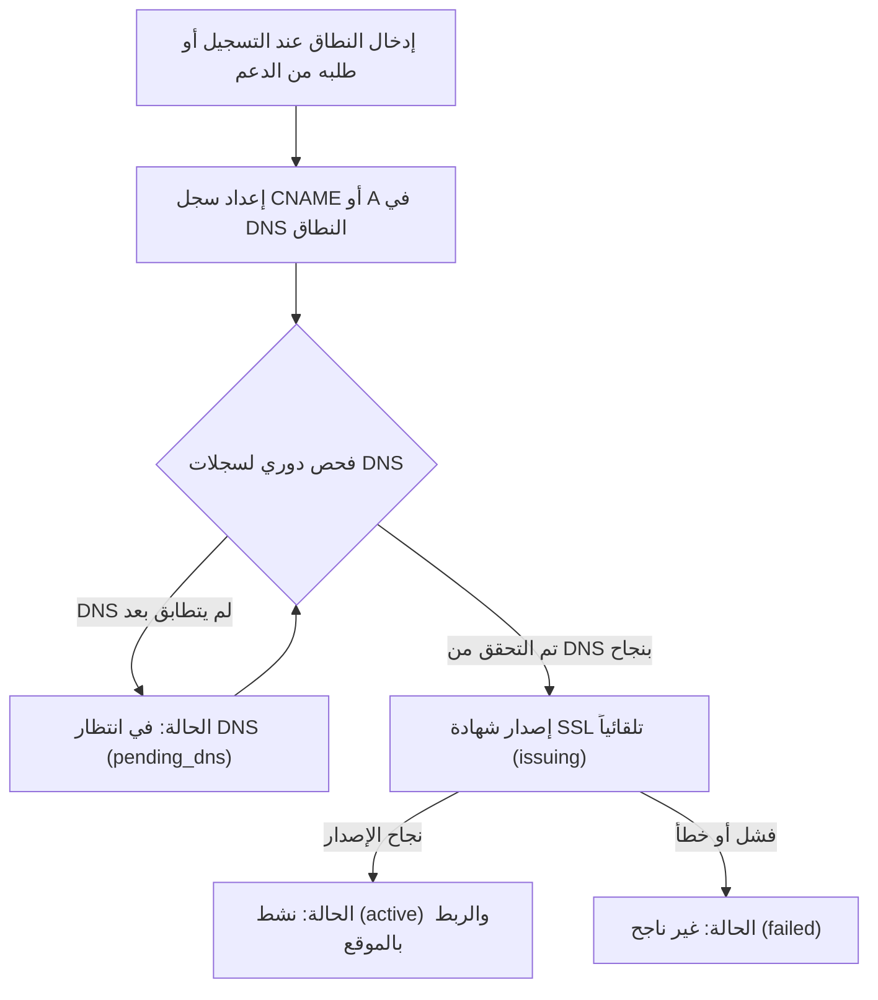

# دليل إعداد النطاق المخصص

**[فارسی](../fa/custom-domain.md) · [English](../en/custom-domain.md) · [العربية](custom-domain.md) · [پښتو](../ps/custom-domain.md)**

يحصل كل اشتراك في منصة أبرك (Abrak) تلقائياً على نطاق فرعي آمن (مثل `mybrand.abrak.org`). إذا كنت ترغب في أن يعمل موقعك الإلكتروني أو متجرك التجاري مباشرة على نطاقك الخاص (مثل `example.com` أو `shop.example.com`)، يمكنك ربط نطاقك المخصص باشتراكك بكل سهولة.

---

## ١. المتطلبات الأساسية

قبل البدء بإعداد النطاق، يرجى التأكد من توفر الآتي:

1. **اشتراك ذو قاعدة بيانات مستقلة:** خدمة توجيه النطاق المخصص متاحة للاشتراكات ذات قواعد البيانات المعزولة (Dedicated Tenant Database).
2. **تثبيت تطبيق الموقع الإلكتروني:** يجب أن يكون تطبيق **الموقع الإلكتروني** (`website`) مثبتاً داخل قاعدة بياناتك، حيث يتم ربط النطاق المخصص مباشرة بسجل الموقع.
3. **صلاحية إدارة DNS:** توفر إمكانية الوصول إلى لوحة تحكم إدارة سجلات DNS الخاصة بنطاقك (لدى مسجل النطاق أو مزود استضافة DNS مثل Cloudflare).

---

## ٢. خطوات الإعداد خطوة بخطوة

### الخطوة الأولى: إعطاء اسم النطاق
- أدخل النطاق عند التسجيل (خيار «النطاق المخصّص»)، أو اطلبه من [دعم أبرك](https://abrak.org/contactus) لخدمة قائمة؛ بدون `http://` أو `https://` (مثال: `shop.example.com`).
- يبدأ موظف أبرك الربط وتصبح الحالة **«في انتظار DNS» (`pending_dns`)**. يصلك السجل الدقيق المطلوب عبر مركز الإشعارات.

### الخطوة الثانية: إعداد سجلات DNS
في لوحة تحكم DNS الخاصة بنطاقك، قم بتطبيق أحد الخيارين:

- **الخيار الأول — سجل CNAME (موصى به للنطاقات الفرعية):**
  - النوع: `CNAME`
  - الاسم (Name): النطاق الفرعي (مثل `shop`)
  - القيمة / الهدف (Value): النطاق الفرعي الافتراضي لاشتراكك في أبرك (مثل `mybrand.abrak.org`)

- **الخيار الثاني — سجل A (ملائم للنطاق الرئيسي أو الفرعي):**
  - النوع: `A`
  - القيمة (IP): عنوان IP لخادم الحافة في أبرك (الموضح في إشعار بدء الربط المرسَل إليك).

> [!NOTE]
> في حال استخدام خدمات إدارة السحابة والبروكسي مثل Cloudflare، يرجى تعطيل وضع البروكسي (السحابة البرتقالية) وجعله (DNS-only) مؤقتاً أثناء عملية التحقق وإصدار شهادة الأمان.

### الخطوة الثالثة: التحقق التلقائي وإصدار شهادة SSL
- يقوم نظام أبرك بفحص سجلات DNS كل ١٠ دقائق.
- بمجرد توجيه السجلات إلى خوادم أبرك، تنتقل الحالة تلقائياً إلى **«قيد إصدار الشهادة» (`issuing`)**.
- يتم إصدار شهادة SSL أمنية معتمدة ومجانية وتجديدها تلقائياً عبر Let's Encrypt من خلال تحدي HTTP-01، ويتم تهيئة التوجيه الآمن على الخوادم.

### الخطوة الرابعة: التفعيل والربط بموقعك الإلكتروني
- بعد إصدار الشهادة بنجاح، تتحول الحالة إلى **«نشط» (`active`)**.
- يتم تحديث عنوان موقعك الإلكتروني الأساسي داخل قاعدة البيانات تلقائياً ليصبح `https://yourdomain.com`.
- يُرسَل إشعار التفعيل عبر مركز الإشعارات ويُسجَّل في سجل الاشتراك.

---

## ٣. حالات النطاق ومعالجة الأخطاء

| الحالة | المعرّف التقني | الشرح والإجراء المطلوب |
|---|---|---|
| **بدون نطاق** | `none` | لم يتم تسجيل أي نطاق مخصص للاشتراك حالياً. |
| **في انتظار DNS** | `pending_dns` | تم تسجيل الطلب، ولكن DNS لا يشير إلى أبرك بعد. قد يستغرق انتشار DNS من بضع دقائق إلى عدة ساعات. |
| **قيد إصدار الشهادة** | `issuing` | تم التحقق من مطابقة DNS، والنظام يعمل على استخراج شهادة SSL تلقائياً. لا يلزم أي إجراء من جانبك. |
| **نشط** | `active` | تم إصدار الشهادة والنطاق يعمل ومرتبط بموقعك بنجاح. يتم تتبع صلاحية الشهادة دورياً. |
| **غير ناجح** | `failed` | تعذر إصدار الشهادة أو الإعداد (مثل عدم تثبيت تطبيق الموقع، أو فشل التحقق من DNS). يظهر السبب بدقة في حقل «آخر رسالة للنطاق». |
| **قيد الحذف** | `removing` | تم طلب إزالة النطاق، والنظام يعمل على مسح التوجيه وإعادة الموقع للنطاق الافتراضي. |

---

## ٤. إزالة النطاق أو تغييره

- لحذف النطاق المخصص أو تغييره، أبلغ [دعم أبرك](https://abrak.org/contactus)؛ يزيله الموظف من الحافة.
- تنتقل الحالة مؤقتاً إلى `removing` حتى اكتمال إزالة التوجيه وإعادة الموقع لنطاقه الافتراضي، ثم تعود الحالة إلى `none`.

---

[العودة إلى فهرس المستندات](README.md)

