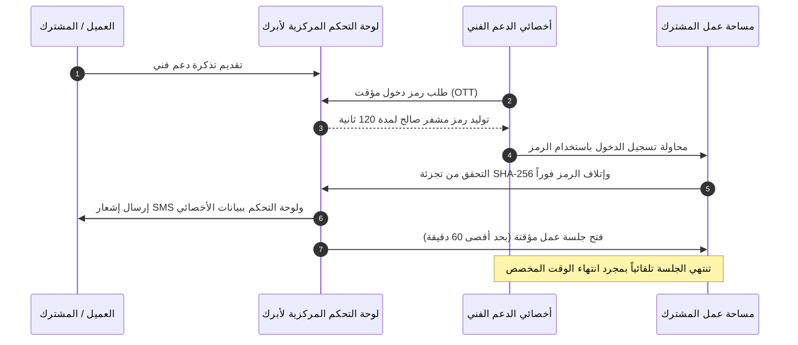

# دليل وصول الدعم الفني وتدقيق الجلسات

**[فارسی](../fa/support-access.md) · [English](../en/support-access.md) · [العربية](support-access.md) · [پښتو](../ps/support-access.md)**

في أنظمة الاستضافة التقليدية، يتطلب حل المشكلات التقنية في كثير من الأحيان مشاركة كلمات مرور المشرف مع مهندسي الدعم، مما يشكل خطراً على خصوصية البيانات وحوكمتها. توفر منصة أبرك (Abrak) بنية أمنية حديثة عديمة المعرفة (Zero-Knowledge) قائمة على الرموز المؤقتة لمرة واحدة (OTT)، وجلسات قصيرة الأجل ومحدودة زمنياً، مع سجل تدقيق شامل وإشعارات فورية عبر الرسائل القصيرة.

---

## ١. متى يلزم وصول الدعم الفني؟

عندما تتقدم بطلب للحصول على مساعدة فنية، أو عند الإبلاغ عن تباين محاسبي أو طلب استكشاف أخطاء متقدمة في تطبيقات أودو المدمجة، قد يحتاج أخصائي تقني معتمد من فريق أبرك إلى الوصول المؤقت لمساحة عملك (Tenant) لمعاينة المشكلة وحلها مباشرة.

---

## ٢. البنية الأمنية عديمة المعرفة (رموز OTT لمرة واحدة)

يعتمد تسجيل دخول الدعم الفني في أبرك على أعلى معايير الأمان ومبدأ الحد الأدنى من الامتيازات (Least Privilege):

- **عدم إنشاء أو مشاركة كلمات المرور:** لا يتم توليد أو حفظ أو مشاركة أي كلمة مرور على الإطلاق. تظل كلمة المرور الإدارية الخاصة بك سرية ومحمية تماماً.
- **رمز مؤقت لمرة واحدة (One-Time Token - OTT):** يتم إنشاء رمز أمني تشفيري عالي العشوائية بحجم 32 بايت لكل عملية دخول على حدة.
- **صلاحية صارمة لمدة دقيقتين (120 ثانية):** يكون الرمز صالحاً للاستخدام لمدة 120 ثانية فقط من لحظة إنشائه، وإذا لم يُستخدم خلال هذه المدة يتم إبطاله نهائياً.
- **تشفير الرمز أثناء التخزين:** يتم تخزين الرمز في الخادم المركزي على هيئة بصمة تشفيرية مجزأة (SHA-256 Hash Digest)، ولا يتم حفظ الرمز الأصلي خاماً بأي شكل.
- **استخدام فردي ومقيد بالأخصائي:** الرمز مخصص حصراً للموظف الذي طلبه، ويتم إتلافه ومسحه فور استخدامه الناجح أو فشله.

---

## ٣. إدارة الجلسة المؤقتة داخل مساحة العمل

بمجرد اكتمال تسجيل الدخول، تخضع جلسة الأخصائي التقني للرقابة المباشرة داخل نظام مساحة عملك:

1. **جلسة مؤقتة ومحددة زمنياً (60 دقيقة افتراضياً):** مدة الجلسة قصيرة الأجل (60 دقيقة افتراضياً، وقابلة للضبط إدارياً بين 5 دقائق و 240 دقيقة).
2. **تسجيل خروج إجباري وتلقائي:** تراقب طبقة الأمان في بيئة عملك وقت الجلسة باستمرار، وبمجرد انقضاء المهلة المحددة، يتم إنهاء الجلسة فوراً وإبطال صلاحيات الدخول (`Session Expired`).

---

## ٤. سجل التدقيق الشامل والإشعارات الفورية

تترك كل عملية دخول للدعم الفني سجلاً رقمياً موثقاً وغير قابل للتعديل:

1. **سجل الاشتراك (Subscription Chatter):**
   - يتم تدوين اسم الأخصائي، معرّف تسجيل الدخول، التوقيت الدقيق، ومدة الجلسة في سجل محادثات الاشتراك الخاص بك.
2. **سجلات النظام التقنية (`ir.logging`):**
   - يسجل خادم مساحة العمل تفاصيل الحدث لأغراض التدقيق الأمني الخارجي.
3. **رسالة نصية قصيرة (SMS) وإشعار فوري:**
   - في لحظة تسجيل الدخول تماماً، تصل رسالة نصية قصيرة تلقائية إلى رقم هاتف مالك الحساب:
   > *"دخل دعم أبرك الفني إلى مساحة عملك في [التاريخ والوقت] لمتابعة طلبك (الخبير: [الاسم]، المدة: 60 دقيقة كحد أقصى). إذا لم تطلب الدعم، يرجى إبلاغنا فوراً."*

---

## ٥. مراجعة وتدقيق الإجراءات

- **تتبع التعديلات:** يتم تسجيل وتوثيق أي مستند أو تعديل يقوم به الأخصائي باسم حسابه الشخصي في سجل محادثات المستندات في أودو.
- **التصرف عند استلام إشعار غير متوقع:** إذا وصلك إشعار بالدخول دون أن تكون قد تقدمت بطلب دعم نشط:
  - أرسل تذكرة أمنية عاجلة فوراً من لوحة تحكم اشتراكك.
  - تواصل مع فريق أبرك عبر القنوات الرسمية لإنهاء أي جلسات نشطة والتحقق من الحساب فوراً.

---

[العودة إلى فهرس المستندات](README.md)

