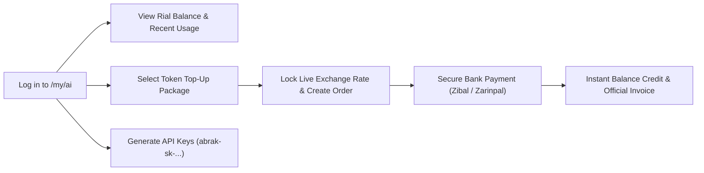

# Personal AI Wallet Top-Up Guide (`/my/ai`)

**[فارسی](../fa/ai-wallet.md) · [English](ai-wallet.md) · [العربية](../ar/ai-wallet.md) · [پښتو](../ps/ai-wallet.md)**

Within the Abrak cloud ecosystem, access to advanced AI models (including the conversational interface at `chat.abrak.org`, enterprise AI assistants, and programmatic API endpoints) is powered by the unified Abrak AI Gateway (`abrak_ai_gateway`). Every individual user and company account maintains a dedicated Rial balance to cover computational token consumption transparently.

---

## 1. Personal vs. Company AI Wallets

Abrak distinguishes between two wallet scopes:

1. **Personal AI Wallet:**
   - Provisioned for each individual registered user on `chat.abrak.org` and the customer portal.
   - Individual chat usage and personal API keys deduct credit directly from this wallet.
2. **Company AI Wallet:**
   - Associated with your company tenant subscription for organizational processes.
   - Authorized internal staff can seamlessly toggle between the company and personal wallets directly in the `/my/ai` portal (`?wallet=personal` or `?wallet=company`).

---

## 2. Accessing the AI Portal (`/my/ai`)

To view your current balance, purchase top-up packages, or manage developer keys:
- Navigate to [abrak.org/my/ai](https://abrak.org/my/ai).
- Sign in with your verified Abrak user credentials.



---

## 3. Features of the `/my/ai` Dashboard

### A) Rial Balance and Recent Usage Breakdown
- Your active credit balance in Rials is prominently displayed at the top of the portal.
- The **Recent Usage** table logs your last 10 model invocations:
  - **Timestamp:** Precise date and time of execution.
  - **Model:** Provider and model identifier (e.g., `cloudflare:@cf/openai/gpt-oss-20b` or catalog models).
  - **Prompt & Completion Tokens:** Exact count of input and output tokens consumed.
  - **Cost:** Billed amount in Rials calculated against approved platform rates.
  - **Channel:** Origin of the request (`API` key or `internal` app module).

### B) Purchasing Top-Up Packages
- Tiered token credit packages are listed to accommodate both individual users and team workflows.
- **Price and FX Rate Lock:** When you initiate a purchase, the package price in Rials and the underlying exchange rate are frozen onto the order ledger. Mid-transaction currency fluctuations will not alter your checkout total.
- **Banking Gateways:** Transactions are processed securely via Iranian payment providers (Zibal, Zarinpal) with built-in idempotency to prevent duplicate charges.
- **Accounting Integration:** Approved top-ups immediately record entries in Odoo's native financial ledger and issue an official invoice.

### C) Managing Personal API Keys
To integrate Abrak AI into your custom software, scripts, or workflows:
1. Under **API Keys**, specify a descriptive label for your key.
2. Select your default model from the dropdown list of active, vetted models (rates per 1 million input and output tokens are displayed alongside each model).
3. Click **Create New Key**.
4. Your API key (prefixed with `abrak-sk-...`) is shown **only once**. Copy and store it securely.

---

## 4. Quickstart with the Official OpenAI SDK

All Abrak AI keys are fully compatible with OpenAI client libraries. Simply configure the `base_url` parameter to point to Abrak's endpoint:

```python
from openai import OpenAI

client = OpenAI(
    base_url="https://abrak.org/ai/v1",
    api_key="abrak-sk-YOUR_PERSONAL_KEY",
)

response = client.chat.completions.create(
    model="openrouter:openrouter/free",
    messages=[
        {"role": "user", "content": "Explain Abrak accounting in two concise sentences."}
    ],
)

print(response.choices[0].message.content)
```

---

## 5. Billing and Support Notes

- **Pay-As-You-Go:** No mandatory monthly subscriptions are attached to the AI wallet; credit is deducted strictly on real token consumption.
- **On-Demand Replenishment:** Add credit at any time as your workload grows.
- If a bank transaction completes but your balance does not reflect the credit immediately, the platform's audit ledger flags the transaction automatically for manual verification by Abrak support.

---

[Back to Documentation Index](README.md)
