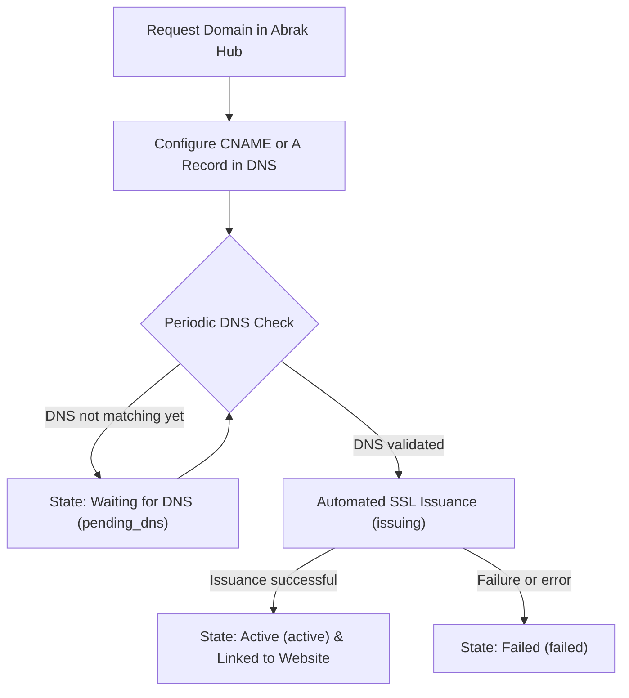

# Custom Domain Setup Guide

**[فارسی](../fa/custom-domain.md) · [English](custom-domain.md) · [العربية](../ar/custom-domain.md) · [پښتو](../ps/custom-domain.md)**

Every Abrak subscription receives a default secure subdomain (such as `mybrand.abrak.org`). If you want your website or e-commerce shop to be directly accessible on your own branded domain (e.g., `example.com` or `shop.example.com`), you can bind your custom domain to your subscription.

---

## 1. Prerequisites

Before setting up your custom domain, confirm the following requirements:

1. **Dedicated Database Subscription:** Custom domain routing is available for subscriptions with an isolated tenant database.
2. **Website App Installed:** Your tenant database must have the native Odoo **Website** app (`website`) installed, as the custom domain binds directly to the website record.
3. **DNS Management Access:** You must have access to manage DNS records for your domain with your DNS provider (such as your registrar, Cloudflare, or hosting control panel).

---

## 2. Step-by-Step Configuration

### Step 1: Submit Your Domain in the Abrak Hub
- Log in to your Abrak subscription dashboard.
- In your subscription settings, enter your domain name without protocols like `http://` or `https://` (for example, `shop.example.com`).
- Once submitted, your domain status will change to **"Waiting for DNS" (`pending_dns`)**.

### Step 2: Configure Your DNS Records
In your domain's DNS management console, choose one of the following methods:

- **Option A — CNAME Record (Recommended for subdomains):**
  - **Type:** `CNAME`
  - **Name / Host:** Your subdomain (e.g., `shop`)
  - **Value / Target:** Your default Abrak tenant hostname (e.g., `mybrand.abrak.org`)

- **Option B — A Record (Applicable for apex or subdomains):**
  - **Type:** `A`
  - **Value / Target:** The Abrak edge IP address shown in your subscription confirmation notice.

> [!NOTE]
> If you are using a reverse proxy or CDN service like Cloudflare, temporarily set the proxy status to "DNS only" (grey cloud) during verification and certificate issuance.

### Step 3: Automatic DNS Verification and SSL Issuance
- Abrak's background scheduler polls and resolves your domain's DNS on an hourly basis.
- As soon as the DNS records point to Abrak's edge servers, the status automatically advances to **"Issuing Certificate" (`issuing`)**.
- A trusted, free SSL certificate is automatically provisioned via Let's Encrypt using the HTTP-01 challenge, and edge routing is securely configured.

### Step 4: Activation and Tenant Website Binding
- Upon successful certificate issuance, the status transitions to **"Active" (`active`)**.
- Your tenant's primary website domain is automatically updated to `https://yourdomain.com`.
- An SMS confirmation and an in-portal notification are dispatched to your registered contacts.

---

## 3. Domain States and Troubleshooting

| State | System Key | Description & Action |
|---|---|---|
| **No Domain** | `none` | No custom domain is currently configured for this subscription. |
| **Waiting for DNS** | `pending_dns` | The domain request is registered, but DNS does not resolve to Abrak yet. DNS propagation may take from a few minutes to several hours. |
| **Issuing Certificate** | `issuing` | DNS matches Abrak edge servers. Automated SSL certificate issuance is in progress. No user action is required. |
| **Active** | `active` | Certificate is issued and the domain is live and linked to your website. Certificate expiry date is tracked automatically. |
| **Failed** | `failed` | Configuration or certificate issuance failed (e.g., Website app not installed, or DNS challenge failure). The exact error reason is displayed in the "Last Domain Message" field. |
| **Removing** | `removing` | A removal request is in progress. Edge routing is being purged and the website domain is reverting to the default host. |

---

## 4. Removing or Changing a Domain

- To delete or replace a custom domain, select the removal option in your subscription portal.
- The status briefly changes to `removing` while edge routing is removed and your website is reset to the default subdomain, before returning to `none`.

---

[Back to Documentation Index](README.md)
