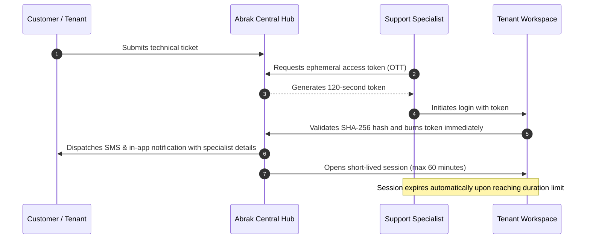

# Support Access and Login Auditing Guide

**[فارسی](../fa/support-access.md) · [English](support-access.md) · [العربية](../ar/support-access.md) · [پښتو](../ps/support-access.md)**

Traditional technical support frequently requires sharing administrator credentials with engineers—a practice that compromises confidentiality and data governance. Abrak addresses this with an ephemeral, passwordless One-Time Token (OTT) mechanism, short-lived sessions, and complete audit logging.

---

## 1. When is Support Access Required?

When you submit a technical assistance request, report an accounting discrepancy, or request deep troubleshooting of native Odoo business applications, an authorized Abrak technical specialist may need temporary access to your tenant workspace to diagnose the issue firsthand.

---

## 2. Zero-Knowledge Passwordless Architecture (OTT)

Abrak support logins follow modern Zero-Knowledge and Principle of Least Privilege security standards:

- **No Passwords Generated or Shared:** No password is ever generated, saved, or exposed. Your administrative password remains confidential and untouched.
- **One-Time Token (OTT):** Each entry generates a cryptographic, high-entropy 32-byte token.
- **Strict 2-Minute Expiry (120 Seconds):** The one-time token is valid for only 120 seconds. If not redeemed within two minutes, it is permanently voided.
- **Hashed at Rest:** Only a cryptographic SHA-256 hash digest is stored on the central server; the raw token does not exist in persistent storage.
- **Single-Use and Bound to Staff:** The token can be consumed exactly once, solely by the specific staff member who requested it. It is purged immediately upon use or failure.

---

## 3. Short-Lived In-Tenant Session Enforcement

Once connected, the specialist's session is strictly managed by your tenant's security layer:

1. **Time-Capped Session (Default 60 Minutes):** Support sessions are intentionally short-lived (capped at 60 minutes).
2. **Automatic Forced Logout:** The tenant runtime continually monitors session longevity. As soon as the time window elapses, the session is forcibly invalidated, and access terminates immediately (`Session Expired`).

---

## 4. Full Audit Trail and Real-Time Notifications

Every support entry produces immutable, verifiable audit records:

1. **Subscription Chatter Log:**
   - The specialist's name, login identifier, Solar Hijri timestamp, and session duration are recorded in your subscription chatter.
2. **System Log Ingestion (`ir.logging`):**
   - Detailed server logs record the access event for external security audits.
3. **Instant SMS & Hub Notification:**
   - At the exact moment of login, an automated notification is sent to your account's primary contact numbers:
   > *"Abrak Support accessed your workspace on [Date & Time] to assist with your request (Specialist: [Name], duration: max 60 minutes). If you did not request support, please notify us immediately."*

---

## 5. Reviewing, Auditing, and Revoking Access

- **Audit Changes:** Every document and configuration modified by the specialist inside your tenant is attributed to their user account in the Odoo chatter.
- **Unexpected Notification Handling:** If you receive a login alert and have not submitted an active support ticket:
  - Immediately submit an urgent security ticket from your hub.
  - Contact Abrak Support through official channels to immediately terminate any active sessions.

---

[Back to Documentation Index](README.md)
