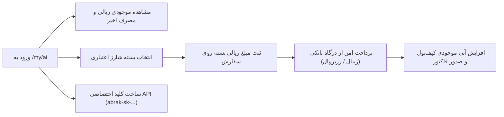

<div align="right" dir="rtl">

# راهنمای شارژ کیف‌پول شخصی هوش مصنوعی (`/my/ai`)

**[فارسی](ai-wallet.md) · [English](../en/ai-wallet.md) · [العربية](../ar/ai-wallet.md) · [پښتو](../ps/ai-wallet.md)**

در اکوسیستم ابری ابرک، دسترسی به مدل‌های پیشرفته هوش مصنوعی (نظیر چت هوشمند در `chat.abrak.org`، هوش مصنوعی داخل اودو و اتصال API) از طریق درگاه یکپارچهٔ هوش مصنوعی ابرک (`abrak_ai_gateway`) مدیریت می‌شود. هر شرکتِ مشترک یک کیف‌پول ریالی دارد و مشتریانِ `chat.abrak.org` کیف‌پول شخصی خودشان را دارند؛ مصرف هر درخواست به ریال از همان کیف‌پول کسر می‌شود.

---

## ۱. کیف‌پول شخصی در برابر کیف‌پول شرکتی

ابرک از دو نوع کیف‌پول بر اساس هویت کاربر پشتیبانی می‌کند:

1. **کیف‌پول شخصی (Personal AI Wallet):**
   - مالِ کاربرانی است که برای چت در `chat.abrak.org` با حساب ابرک وارد می‌شوند و اشتراک سازمانی جدا ندارند. با اولین ورود به `/my/ai` ساخته می‌شود.
   - چت شخصی در `chat.abrak.org` و کلیدهای API همین کاربر از این کیف‌پول کسر می‌شود. اگر کیف‌پول شارژ نشده باشد، درخواست با پیام «اعتبار کافی نیست» متوقف می‌شود و از هیچ کیف‌پول دیگری برداشت نمی‌شود.
2. **کیف‌پول شرکتی (Company AI Wallet):**
   - مالِ اشتراکِ کسب‌وکار است و هوش مصنوعیِ داخل اودوی همان شرکت از آن مصرف می‌کند.
   - **شارژ کیف‌پول شرکتی و ساخت یا تغییر کلید API فقط برای صاحب اشتراک است.** کاربران دیگرِ همان شرکت در `/my/ai` موجودی و مصرف را می‌بینند تا بدانند چرا هوش مصنوعی متوقف شده، ولی دکمهٔ شارژ و بخش کلیدها برایشان نمایش داده نمی‌شود.

---

## ۲. دسترسی به پرتال مدیریت هوش مصنوعی (`/my/ai`)

جهت مشاهده وضعیت، بسته‌های شارژ و مدیریت کلیدها:
- به نشانی [abrak.org/my/ai](https://abrak.org/my/ai) مراجعه نمایید.
- با نام کاربری و رمز عبور اشتراک خود وارد شوید.



---

## ۳. قابلیت‌های پرتال `/my/ai`

### الف) موجودی ریالی و شفافیت مصرف اخیر
- در بالای صفحه، موجودی فعال کیف‌پول شما به ریال نمایش داده می‌شود.
- در جدول **«مصرف اخیر»**، ۱۰ فراخوانی آخر مدل‌های هوش مصنوعی با جزییات دقیق ثبت است:
  - **زمان:** تاریخ و ساعت فراخوانی.
  - **مدل:** نام ارائه‌دهنده و مدل پردازش‌شده (مانند `cloudflare:@cf/openai/gpt-oss-20b` یا مدل‌های تأییدشده).
  - **توکن ورودی و خروجی:** تعداد دقیق توکن‌های ارسال‌شده و دریافت‌شده.
  - **هزینه:** مبلغ کسرشده به ریال بر اساس تعرفهٔ مصوب.
  - **مسیر (Channel):** تمایز میان استفاده از طریق کلید API یا ماژول‌های داخلی.

### ب) خرید بسته‌های شارژ اعتباری (Top-Up Packages)
- بسته‌های متنوع اعتباری متناسب با حجم مصرف شخصی یا تیمی در صفحه فهرست شده‌اند.
- **ثابت ماندن مبلغ در حین پرداخت:** قیمت بسته با نرخ ارز همان لحظه به ریال حساب و روی سفارش و تراکنش ثبت می‌شود. اگر نرخ ارز در حین پرداخت تغییر کند، مبلغی که می‌پردازید و اعتباری که می‌گیرید تغییر نمی‌کند. خریدِ بعدی با نرخ روزِ همان زمان حساب می‌شود.
- **درگاه پرداخت بانکی شاپرک:** پرداخت از طریق درگاه‌های امن و تأییدشده نظیر زیبال و زرین‌پال صورت می‌گیرد.
- **ثبت در دفترکل مالی:** هر تراکنش موفق در دفترکل حسابداری ثبت شده، از پرداخت‌های تکراری جلوگیری می‌کند و فاکتور رسمی بومی اودوو صادر می‌گردد.

### ج) ساخت و مدیریت کلیدهای اختصاصی API
چنانچه می‌خواهید هوش مصنوعی ابرک را به نرم‌افزارهای اختصاصی، وب‌سایت، یا افزونه‌های خود متصل کنید:
1. در بخش **«کلیدهای API»**، عنوانی برای کلید خود برگزینید.
2. از میان فهرست مدل‌های فعال و تأییدشدهٔ ابرک، مدل پیش‌فرض مورد نظرتان را انتخاب کنید (تعرفهٔ ریالی هر یک میلیون توکن ورودی و خروجی در برابر هر مدل درج شده است).
3. دکمهٔ **«ساخت کلید جدید»** را بزنید.
4. کلید تولیدشده با پیشوند `abrak-sk-...` تنها **یک‌بار** به شما نمایش داده می‌شود؛ آن را در محلی امن یادداشت و نگهداری فرمایید.

---

## ۴. نمونه شروع سریع با SDK استاندارد OpenAI

تمامی کلیدهای API ابرک با ساختار استاندارد OpenAI سازگارند؛ کافی است مقدار `base_url` را به سرور ابرک هدایت کنید:

```python
from openai import OpenAI

client = OpenAI(
    base_url="https://abrak.org/ai/v1",
    api_key="abrak-sk-YOUR_PERSONAL_KEY",
)

response = client.chat.completions.create(
    model="cloudflare:@cf/openai/gpt-oss-20b",
    messages=[
        {"role": "user", "content": "سلام، راهنمای حسابداری ابرک را خلاصه کن."}
    ],
)

print(response.choices[0].message.content)
```

---

## ۵. نکات کلیدی و پشتیبانی

- **کسر هزینه‌ها بر اساس مصرف واقعی:** هیچ آبونمان ماهیانه اجباری برای کیف‌پول هوش مصنوعی وجود ندارد؛ تنها به میزان توکن‌های مصرف‌شده از اعتبار ریالی شما کسر می‌شود.
- **هشدار کمبود اعتبار:** وقتی موجودی از حد هشدار پایین‌تر برود یا تمام شود، پیام از مرکز اعلان ابرک می‌رسد. شارژ خودکار وجود ندارد؛ هر بار بسته را خودتان می‌خرید.
- اگر پرداخت بانکی انجام شد ولی اعتبار اضافه نشد، پرداخت در وضعیت «در حال بررسی» ثبت می‌شود و صفحهٔ نتیجهٔ پرداخت همین را نشان می‌دهد. پس از بررسی، اعتبار اضافه یا مبلغ بازگردانده می‌شود.

---

[بازگشت به فهرست مستندات](README.md)

</div>
