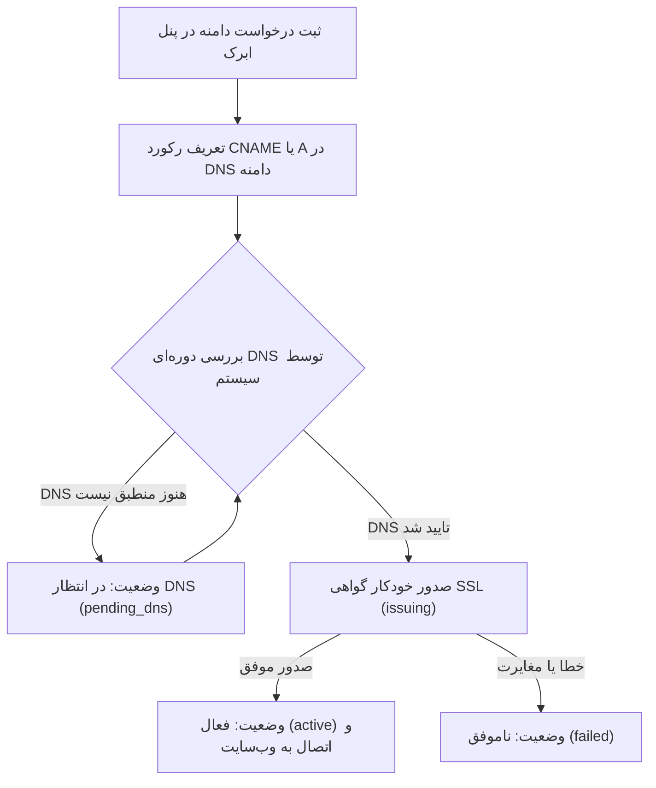

# راهنمای اتصال دامنهٔ اختصاصی

**[فارسی](custom-domain.md) · [English](../en/custom-domain.md) · [العربية](../ar/custom-domain.md) · [پښتو](../ps/custom-domain.md)**

در ابرک، هر اشتراک به صورت پیش‌فرض یک زیردامنهٔ امن (مانند `mybrand.abrak.org`) دریافت می‌کند. چنانچه تمایل دارید وب‌سایت یا فروشگاه اینترنتی شما مستقیماً روی نشانی اینترنتی اختصاصی خودتان (مانند `example.com` یا `shop.example.com`) در دسترس باشد، می‌توانید دامنهٔ اختصاصی خود را به اشتراک متصل نمایید.

---

## ۱. پیش‌نیازها

پیش از آغاز اتصال دامنه، موارد زیر را بررسی فرمایید:

1. **نوع پایگاه‌دادهٔ اشتراک:** اتصال دامنهٔ اختصاصی برای اشتراک‌های دارای پایگاه‌دادهٔ مستقل (Isolated Database) فعال است.
2. **نصب اپلیکیشن وب‌سایت:** پایگاه‌دادهٔ شما باید مجهز به اپلیکیشن بومی **وب‌سایت** (`website`) باشد؛ چرا که دامنه مستقیماً بر روی وب‌سایت تننت شما پیکربندی می‌شود.
3. **دسترسی به مدیریت DNS:** دسترسی به پنل مدیریت دامنه‌تان نزد کارگزار DNS (مانند پنل ثبت‌کننده دامنه، کلودفلر یا ارائه‌دهنده میزبانی) جهت تعریف رکوردها الزامی است.

---

## ۲. مراحل اتصال گام‌به‌گام

### گام اول: ثبت نام دامنه در پنل کاربری ابرک
- وارد پنل مدیریت اشتراک خود در ابرک شوید.
- در بخش تنظیمات اشتراک، نام دامنهٔ خود را بدون پیشوندهای اضافی `http://` یا `https://` وارد نمایید (مثال: `shop.example.com`).
- با فشردن دکمه ثبت درخواست، وضعیت دامنه به **«در انتظار DNS» (`pending_dns`)** تغییر می‌یابد.

### گام دوم: تنظیم رکوردهای DNS دامنه
در پنل مدیریت DNS دامنهٔ خود، یکی از دو روش زیر را اعمال کنید:

- **روش اول — رکورد CNAME (توصیه‌شده برای ساب‌دامین‌ها):**
  - نوع رکورد: `CNAME`
  - نام (Name): زیردامنهٔ شما (مانند `shop`)
  - مقدار (Value / Target): نشانی ساب‌دامین پیش‌فرض اشتراک شما در ابرک (مانند `mybrand.abrak.org`)

- **روش دوم — رکورد A (مناسب برای ریشه یا ساب‌دامین):**
  - نوع رکورد: `A`
  - مقدار (IP): نشانی IP سرور لبهٔ ابرک (که در پیام ثبت درخواست در پنل اشتراک به شما اعلام شده است).

> [!NOTE]
> در صورتی که از سرویس‌های مدیریت ابری نظیر کلودفلر استفاده می‌کنید، در هنگام صدور گواهی وضعیت پروکسی (ابر نارنجی) را موقتاً غیرفعال (DNS-only) قرار دهید تا اعتبارسنجی خودکار بدون مانع انجام شود.

### گام سوم: بررسی خودکار و صدور گواهی امنیتی SSL
- سیستم پایشگر ابرک در فواصل منظم ساعتی وضعیت انتشار DNS شما را ارزیابی می‌کند.
- به محض شناسایی و انطباق رکورد با سرورهای لبهٔ ابرک، وضعیت به **«در حال صدور گواهی» (`issuing`)** تغییر یافته و یک گواهی امنیتی معتبر SSL (از Let's Encrypt) از طریق چالش خودکار HTTP-01 صادر می‌گردد.
- تنظیمات امن روتینگ سرور لبه اعمال شده و دامنه به صورت امن آماده پاسخگویی می‌شود.

### گام چهارم: فعال‌سازی و اتصال به وب‌سایت تننت
- پس از صدور گواهی، وضعیت به **«فعال» (`active`)** تغییر می‌یابد.
- آدرس وب‌سایت اصلی تننت شما در پایگاه‌داده به صورت خودکار به نشانی امن `https://yourdomain.com` به‌روزرسانی می‌شود.
- هم‌زمان، پیامک تأیید و اعلان رسمی در محیط کاربری برای شما ارسال می‌گردد.

---

## ۳. وضعیت‌ها و پیام‌های خطا

| وضعیت | برچسب سیستمی | معنی و اقدام لازم |
|---|---|---|
| **بدون دامنه** | `none` | هیچ دامنهٔ اختصاصی برای اشتراک ثبت نشده است. |
| **در انتظار DNS** | `pending_dns` | رکورد در پنل شما ثبت شده، اما DNS هنوز به ابرک اشاره نمی‌کند. انتشار DNS بین چند دقیقه تا چند ساعت زمان می‌برد. |
| **در حال صدور گواهی** | `issuing` | انطباق DNS تایید شده و سیستم در حال دریافت خودکار گواهی SSL است. نیازی به اقدام کاربر نیست. |
| **فعال** | `active` | گواهی صادر شده و دامنه به وب‌سایت شما متصل است. تاریخ اعتبار گواهی در یادداشت نمایش داده می‌شود. |
| **ناموفق** | `failed` | صدور گواهی یا پیکربندی با خطا مواجه شده است (مانند عدم نصب اپلیکیشن وب‌سایت یا خطای اعتبارسنجی DNS). علت دقیق در فیلد «آخرین پیام دامنه» ثبت است. |
| **در حال حذف** | `removing` | درخواست حذف دامنه ثبت شده و سیستم در حال حذف روتینگ لبه و بازگرداندن دامنه پیش‌فرض است. |

---

## ۴. حذف یا تغییر دامنه

- برای حذف یا تغییر دامنه، در پنل اشتراک گزینهٔ حذف دامنه را انتخاب فرمایید.
- وضعیت به صورت موقت به `removing` تغییر یافته و پس از پاک‌سازی روتینگ سرور لبه و بازگشت آدرس وب‌سایت به ساب‌دامین پیش‌فرض ابرک، اشتراک به وضعیت اولیه `none` بازمی‌گردد.

---

[بازگشت به فهرست مستندات](README.md)

