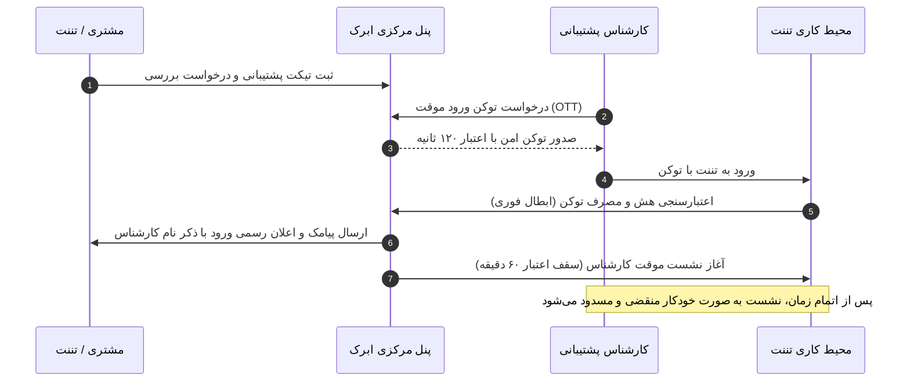

# راهنمای دسترسی پشتیبانی و نظارت بر ورود کارشناسان

**[فارسی](support-access.md) · [English](../en/support-access.md) · [العربية](../ar/support-access.md) · [پښتو](../ps/support-access.md)**

در سیستم‌های سنتی، حل مشکلات فنی اغلب مستلزم ارائهٔ کلمهٔ عبور حساب کاربری به کارشناسان پشتیبانی است؛ رویکردی که ناقض اصول بنیادین امنیت و محرمانگی داده‌هاست. در ابرک، سازوکار دسترسی پشتیبانی بر پایهٔ ورود یک‌بارمصرف امن بدون رمز عبور، محدودیت زمانی سخت‌گیرانه، و ثبت شفاف تمامی رویدادها طراحی شده است.

---

## ۱. ورود پشتیبانی چه زمانی لازم است؟

هنگامی که شما یک تیکت فنی، مالی یا پشتیبانی جهت رفع اشکال در پیکربندی، گزارش مغایرت در اسناد، یا عیب‌یابی اپلیکیشن‌های بومی ثبت می‌کنید، کارشناس متخصص ابرک ممکن است برای بررسی میدانی و شبیه‌سازی مشکل، نیازمند ورود موقت به محیط کاری تننت شما باشد.

---

## ۲. اصول امنیتی ورود بدون کلمهٔ عبور (OTT)

ورود کارشناسان پشتیبانی بر مبنای استانداردهای مدرن Zero-Knowledge و Least-Privilege انجام می‌شود:

- **عدم نیاز به رمز عبور:** هیچ کلمهٔ عبوری تولید، ذخیره یا مشاهده نمی‌شود. رمز عبور شخصی مدیر و کاربران تننت کاملاً دست‌نخورده و محرمانه باقی می‌ماند.
- **توکن یک‌بارمصرف (One-Time Token):** برای هر درخواست ورود، یک توکن تصادفی ۳۲ بایتی منحصر‌به‌فرد تولید می‌شود.
- **اعتبار حداکثر ۲ دقیقه‌ای (۱۲۰ ثانیه):** توکن موقت تنها به مدت ۱۲۰ ثانیه معتبر است. در صورت عدم اتصال کارشناس در این بازه، توکن به صورت خودکار باطل می‌شود.
- **رمزنگاری در حالت سکون:** روی سرور، تنها چکیدهٔ هش رمزنگاری‌شده (SHA-256) توکن ذخیره می‌گردد و اصل توکن در پایگاه‌داده وجود ندارد.
- **تک‌استفاده و مقید به هویت کارشناس:** هر توکن فقط یک‌بار قابل مصرف است و صرفاً برای کارشناس درخواست‌کننده معتبر خواهد بود؛ پس از یک‌بار ورود، توکن فوراً از دیتابیس پاک می‌شود.

---

## ۳. کنترل و انقضای خودکار نشست درون تننت

پس از اتصال کارشناس پشتیبانی، دسترسی تحت مراقبت مستقیم زیرسیستم امنیتی تننت شما قرار دارد:

1. **سقف زمانی محدود (پیش‌فرض ۶۰ دقیقه):** نشست پشتیبانی برخلاف نشست‌های عادی، دارای طول عمر کوتاه است (به صورت پیش‌فرض ۶۰ دقیقه و قابل تنظیم سیستمی بین ۵ تا ۲۴۰ دقیقه).
2. **اخراج خودکار در پایان مهلت:** ماژول محافظ هستهٔ تننت به صورت مستمر زمان نشست را پایش می‌کند. به محض پایان مهلت زمانی، نشست به صورت اجباری خاتمه یافته و دسترسی کارشناس به طور کامل قطع می‌گردد (`Session Expired`).

---

## ۴. شفافیت و ثبت ردپای کامل (Audit Trail)

ابرک تضمین می‌کند که هیچ ورودی بدون اطلاع و ثبت ردپا رخ ندهد:

1. **ثبت در یادداشت‌های اشتراک (Chatter):**
   - نام کامل کارشناس، شناسه ورود، تاریخ و ساعت دقیق ورود به تقویم شمسی و مدت زمان مجاز نشست در پنل اشتراک شما ثبت می‌شود.
2. **ثبت لاگ‌های رسمی سیستم (`ir.logging`):**
   - سوابق سیستمی دقیق جهت ممیزی‌های امنیتی دوره‌ای نگهداری می‌شوند.
3. **اعلان فوری پیامکی و پرتال:**
   - به محض ورود کارشناس، یک پیامک رسمی به شماره‌های تماس ثبت‌شده در اشتراک ارسال می‌گردد:
   > *«پشتیبانی ابرک در تاریخ [تاریخ شمسی و ساعت] برای رسیدگی به درخواست شما وارد حساب‌تان شد (کارشناس: [نام کارشناس]، حداکثر ۶۰ دقیقه). اگر درخواستی نداشته‌اید، به پشتیبانی خبر دهید.»*

---

## ۵. نحوه تأیید، نظارت و لغو دسترسی

- **نظارت بر تغییرات:** تمام اقدامات و سندهای ثبت‌شده توسط کارشناس در داخل تننت با نام مشخص ایشان در تاریخچهٔ رکوردهای اودوو مستند است.
- **لغو یا اعلام ورود غیرمنتظره:** چنانچه پیامک یا اعلان ورود دریافت نمودید بدون آنکه تیکت یا درخواستی ثبت کرده باشید:
  - بلافاصله از طریق بخش تیکت‌ها موضوع را گزارش دهید.
  - می‌توانید با بخش حراست و پشتیبانی ابرک تماس حاصل نموده تا کلیه نشست‌های فعال فوراً فسخ گردد.

---

[بازگشت به فهرست مستندات](README.md)

