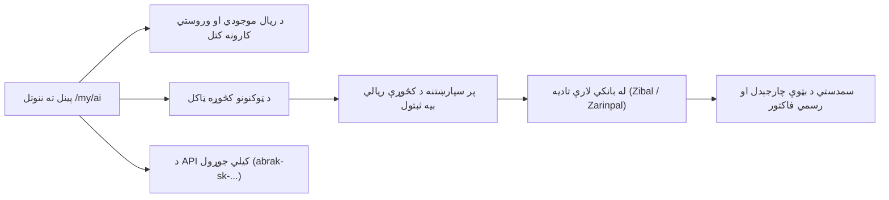

<div align="right" dir="rtl">

# د مصنوعي ځیرکتیا د شخصي بټوې چارجول (`/my/ai`)

**[فارسی](../fa/ai-wallet.md) · [English](../en/ai-wallet.md) · [العربية](../ar/ai-wallet.md) · [پښتو](ai-wallet.md)**

په ابرک (Abrak) کې ټولو پرمختللو مصنوعي ځیرکتیا (AI) ماډلونو ته لاسرسی — که د خبرو اترو پر مخ `chat.abrak.org` کې وي، که په سوداګریزو اتومات کارونو کې وي، یا هم د پروګرام جوړونې د API له لارې — د ابرک د مصنوعي ځیرکتیا د واحدې دروازې (`abrak_ai_gateway`) لخوا برابریږي. هر کارونکی او هر شرکت په ریال یوه ځانګړې مالي بټوه لري چې په پوره روڼتیا د ټوکنونو (Tokens) د کارولو لګښت پټوي.

---

## ۱. شخصي او شرکتي مالي بټوه

ابرک د کارونې له مخې دوه ډوله بټوې بېلې کړې دي:

1. **شخصي بټوه (Personal AI Wallet):**
   - د هغو کسانو لپاره ده چې د ابرک په حساب `chat.abrak.org` ته ننوځي او جلا سوداګریز ګډون نه لري. په `/my/ai` کې د لومړي ځل ننوتلو سره جوړېږي.
   - په `chat.abrak.org` کې د دوی چټ او د دوی خپلې API کیلي له همدې بټوې څخه کسر کیږي. که بټوه چارج نه وي، غوښتنه د «کافي اعتبار نشته» پیغام سره درېږي او له بلې هېڅ بټوې څخه پیسې نه اخیستل کیږي.
2. **شرکتي بټوه (Company AI Wallet):**
   - د سوداګریز ګډون پورې اړه لري؛ د همغه شرکت په اودو کې د مصنوعي ځیرکتیا امکانات له دې څخه لګښت کوي.
   - **د شرکتي بټوې چارجول او د API کیلي جوړول یا بدلول یوازې د ګډون څښتن ته اجازه لري.** د همدې شرکت نور کاروونکي په `/my/ai` کې پاتې اعتبار او مصرف ویني، چې پوه شي ولې مصنوعي ځیرکتیا ودرېده، خو د چارج او کیلي برخې ورته نه ښکاري.

---

## ۲. د بټوې مدیریت پینل ته تګ (`/my/ai`)

د خپل اوسني موجودي د لیدلو، د نویو کڅوړو د اخیستلو، یا د API د کیلي جوړولو لپاره:
- دې ادرس ته لاړ شئ: [abrak.org/my/ai](https://abrak.org/my/ai).
- په خپل باوري کارن حساب سره سیسټم ته ننوځئ.



---

## ۳. د پورټال اسانتیاوې او برخې

### الف) د ریال موجودي او د وروستیو کارونو تاریخچه
- ستاسې فعاله مالي موجودي په ریال د پاڼې په سر کې ښودل کیږي.
- د **وروستیو کارونو** په جدول کې د وروستیو ۱۰ پوښتنو او ځوابونو تفصیلي معلومات ښکاري:
  - **نېټه او وخت:** د پوښتنې د پروسس دقیق وخت.
  - **ماډل (Model):** کارول شوی ماډل (لکه `cloudflare:@cf/openai/gpt-oss-20b` یا نور ماډلونه).
  - **ورودي او وتلي ټوکنونه:** د پوښتنې او ځواب د ټوکنونو دقیقه شمېره (Prompt & Completion Tokens).
  - **لګښت:** له بټوې څخه په ریال ګرځول شوې رسمي بیه.
  - **لار (Channel):** ایا غوښتنه له پروګرامینګ کیلي (`API`) څخه راغلې که د اودو له داخلي سیسټم (`internal`).

### ب) د نویو کڅوړو پېرودل
- د بېلابېلو کچو کڅوړې د شخصي کارونې او د شرکتونو د لویو اړتیاوو لپاره شتون لري.
- **د تادیې پر مهال ثابته بیه:** د کڅوړې بیه د همغې شېبې د اسعارو په نرخ ریال ته اړول کیږي او پر سپارښتنه او معامله ثبتیږي. که د تادیې پر مهال نرخ بدل شي، نه هغه پیسې چې تاسې یې ورکوئ بدلیږي او نه هغه اعتبار چې ترلاسه کوئ. بله پېرودنه د هغې ورځې په نرخ حسابیږي.
- **باوري بانکي دروازې:** پیسې د ایراني باوري بانکي دروازو (زیبال او زرین‌پال) له لارې ورکول کیږي او سیسټم د غلطیو او تکراري پیسو کسر پر وړاندې خوندي دی.
- **د اودو رسمي مالي سندونه:** د پیسو له بریالۍ ورکړې وروسته سمدستي د اودو په رسمي مالي ډېټابېس کې سند او فاکتور جوړیږي او ستاسې حساب چارج کیږي.

### ج) د API کیلیو مدیریت (Personal API Keys)
که غواړئ د ابرک مصنوعي ځیرکتیا له خپلو بهرنیو پروګرامونو یا وېبپاڼو سره ونښلوئ:
1. په پینل کې د **API Keys** برخه کې خپلې کیلي ته یو نوم وټاکئ.
2. د موجودو باوري ماډلونو له نوملړ څخه خپل اصلي ماډل وټاکئ (د هر یو میلیون ټوکن بیه ترڅنګ ښودل شوې ده).
3. د **Create New Key** تڼۍ کېکاږئ.
4. جوړه شوې کیلي (چې په `abrak-sk-...` پیلیږي) **یوازې یو ځل** درته ښودل کیږي؛ هغه کاپي کړئ او په خوندي ځای کې یې وساتئ.

---

## ۴. د رسمي OpenAI SDK له لارې د پروګرام نښلول

د ابرک کیليګانې د OpenAI له رسمي کتابتونونو سره سل په سلو کې سمون خوري. یوازې د ادرس ځای (`base_url`) د ابرک پر لور وټاکئ:

```python
from openai import OpenAI

client = OpenAI(
    base_url="https://abrak.org/ai/v1",
    api_key="abrak-sk-YOUR_PERSONAL_KEY",
)

response = client.chat.completions.create(
    model="cloudflare:@cf/openai/gpt-oss-20b",
    messages=[
        {"role": "user", "content": "د ابرک د مالي حسابونو په هکله په دوو لنډو جملو کې معلومات راکړه."}
    ],
)

print(response.choices[0].message.content)
```

---

## ۵. د بېل او ملاتړ اړین ټکي

- **یوازې د مصرف پر بنسټ تادیه:** د مصنوعي ځیرکتیا بټوه هېڅ جبري میاشتنی فیس نه لري؛ تاسې یوازې د خپلو حقیقي مصرف شوو ټوکنونو لګښت ورکوئ.
- **هر وخت چارجول:** د خپلې اړتیا په اندازه هر کله چې وغواړئ خپله بټوه چارجولی شئ.
- که له بانک څخه پیسې کسر شي خو بټوه سمدلاسه چارج نشي، د سیسټم په مالي تفتیش کې دا چاره په اتومات ډول ښکاري او د ملاتړ ټیم یې په چټکۍ ستونزه حل کوي.

---

[بېرته د لارښودونو نوملړ ته](README.md)

</div>
