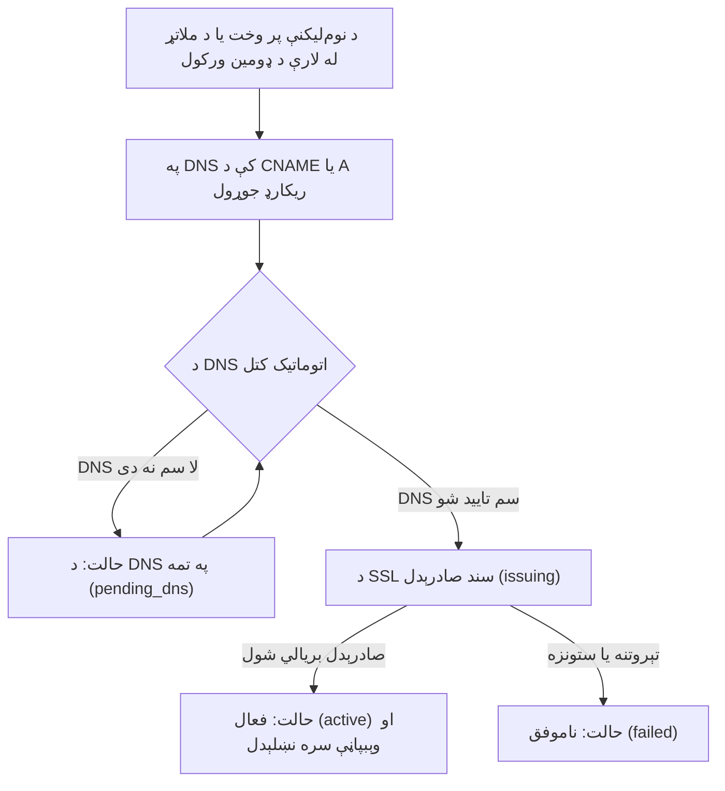

# د ځانګړي ډومین د تنظیم لارښود

**[فارسی](../fa/custom-domain.md) · [English](../en/custom-domain.md) · [العربية](../ar/custom-domain.md) · [پښتو](custom-domain.md)**

په ابرک (Abrak) کې هر کاري ځای په اتومات ډول یو خوندي فرعي ډومین (لکه `mybrand.abrak.org`) لري. که غواړئ ستاسې وېبپاڼه یا سوداګریز پلورنځی په مستقیم ډول پر خپل ځانګړي ډومین (لکه `example.com` یا `shop.example.com`) کار وکړي، تاسې کولی شئ خپل ډومین په ډېرې اسانۍ له خپل ګډون سره ونښلوئ.

---

## ۱. بنسټیز اړتیاوې او شرایط

مخکې له دې چې د ډومین تنظیم پیل کړئ، ډاډ ترلاسه کړئ چې لاندې ټکي چمتو دي:

1. **جلا ډېټابېس لرل:** د ځانګړي ډومین نښلول یوازې د هغو ګډونونو لپاره شوني دي چې جلا ډېټابېس (Dedicated Tenant Database) لري.
2. **د وېبپاڼې کړنلاره (Website App):** باید ستاسې په کاري ځای کې د **وېبپاڼې** رسمي کړنلاره (`website`) فعاله او انسټال شوې وي؛ ځکه چې ځانګړی ډومین په مستقیم ډول د وېبپاڼې له ریکارډ سره تړل کیږي.
3. **د DNS مدیریت پینل ته لاسرسی:** تاسې باید د خپل ډومین د DNS ترتیباتو او ریکارډونو بدلولو پینل (د ډومین په ثبتونکي یا کلاوډفلیر کې) ته لاسرسی ولرئ.

---

## ۲. ګام په ګام د ډومین نښلول

### لومړی ګام: د ډومین نوم ورکول
- ډومین د نوم‌لیکنې پر وخت («ځانګړی ډومین» غوراوی) ولیکئ، یا د روان خدمت لپاره یې له [ابرک ملاتړ](https://abrak.org/contactus) وغواړئ؛ پرته له `http://` او `https://` (د بېلګې په توګه: `shop.example.com`).
- د ابرک کارپوه نښلول پیلوي او حالت **«د DNS په تمه» (`pending_dns`)** کیږي. هغه دقیق ریکارډ چې باید یې جوړ کړئ، د خبرتیاوو د مرکز له لارې درلېږل کیږي.

### دویم ګام: د DNS ریکارډونو تنظیم
د خپل ډومین د تنظیماتو په پینل کې، له لاندې دوو لارو څخه یوه وټاکئ:

- **لومړۍ لاره — د CNAME ریکارډ (د فرعي ډومینونو لپاره غوره دی):**
  - ډول (Type): `CNAME`
  - نوم (Name): ستاسې د فرعي ډومین نوم (لکه `shop`)
  - موخه (Target / Value): ستاسې د ابرک اصلي فرعي ډومین (لکه `mybrand.abrak.org`)

- **دویمه لاره — د A ریکارډ (د اصلي یا فرعي ډومین لپاره):**
  - ډول (Type): `A`
  - ارزښت (Value / IP): د ابرک د سرور IP پته (چې د نښلولو د پیل په خبرتیا کې درلېږل کیږي).

> [!NOTE]
> که تاسې د Cloudflare په څېر د CDN او پروکسي خدمتونه کاروئ، مهرباني وکړئ د تصدیق او SSL سند د جوړېدو پر مهال پروکسي بنده کړئ (DNS-only کړئ) ترڅو د تصدیق چکونه په سمه توګه سرته ورسیږي.

### دریم ګام: اتوماتیک تصدیق او د SSL امنیتي سند صادرول
- د ابرک سیسټم هر ۱۰ دقیقې ستاسې د ډومین د DNS حالت ګوري.
- کله چې ریکارډونه د ابرک پر لور برابر شي، حالت په اتومات ډول **«د صادرېدو په حال کې» (`issuing`)** ته اوړي.
- د Let's Encrypt له لارې په وړیا او اتومات ډول د اعتبار وړ SSL سند د HTTP-01 ازموینې پر مټ صادر او په اتومات ډول نوی (تمدید) کیږي.

### څلورم ګام: فعالېدل او له وېبپاڼې سره بشپړ نښلېدل
- د سند له صادرېدو وروسته، حالت **«فعال» (`active`)** ته بدلیږي.
- ستاسې په ډېټابېس کې د وېبپاڼې اصلي ادرس په اتومات ډول پر `https://yourdomain.com` برابریږي.
- د فعالېدو خبرتیا د خبرتیاوو د مرکز له لارې درلېږل کیږي او د ګډون په سوابقو کې ثبتیږي.

---

## ۳. د ډومین بېلابېل حالتونه او د تېروتنو حل

| حالت | تخنیکي پېژندنه | مانا او اړین ګام |
|---|---|---|
| **هېڅ ډومین نشته** | `none` | د دې ګډون لپاره تر اوسه کوم ځانګړی ډومین نه دی ثبت شوی. |
| **د DNS په تمه** | `pending_dns` | غوښتنه ثبت ده، خو DNS لا سم نه دی تنظیم شوی. د انټرنیټ پر مخ د DNS خپرېدل له څو دقیقو تر څو ساعتونو وخت نیولی شي. |
| **د سند صادرېدل** | `issuing` | د DNS پته تایید شوې، او سیسټم د SSL سند جوړوي. دلته ستاسې لخوا هېڅ کار ته اړتیا نشته. |
| **فعال** | `active` | سند صادر شوی، ډومین له وېبپاڼې سره نښلول شوی او ټول خدمتونه فعال دي. |
| **ناموفق** | `failed` | د سند په صادرولو یا وېبپاڼې په موندلو کې ستونزه راغلې (لکه د Website کړنلارې نه نصبېدل یا د DNS ناسموالی). تفصیلي لامل د ډومین د وروستي پیغام په برخه کې ولولئ. |
| **د لیرې کولو په حال کې** | `removing` | د ډومین د ړنګولو غوښتنه شوې ده، او سیسټم د ډومین د لیرې کولو پروسه بشپړوي. |

---

## ۴. د ډومین بدلول یا لیرې کول

- که غواړئ خپل ځانګړی ډومین لیرې یا بدل کړئ، [ابرک ملاتړ](https://abrak.org/contactus) ته ووایاست؛ کارپوه یې له څنډې لیرې کوي.
- حالت د لږ وخت لپاره `removing` کیږي ترڅو د سرور تنظیمات پاک شي، او وروسته حالت بېرته `none` کیږي او ستاسې وېبپاڼه بېرته پر اصلي فرعي ډومین بدلیږي.

---

[بېرته د لارښودونو نوملړ ته](README.md)

