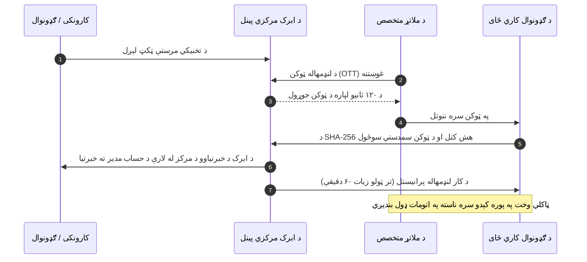

# د ملاتړ لاسرسي او د ناستو د څارنې لارښود

**[فارسی](../fa/support-access.md) · [English](../en/support-access.md) · [العربية](../ar/support-access.md) · [پښتو](support-access.md)**

په دودیزو او پخوانیو سرورونو کې، د تخنیکي ستونزو د حل لپاره ډېری وخت اړتیا وه چې کارونکي خپل اصلي پټنومونه (Passwords) د ملاتړ انجنیرانو ته ورکړي، چې دا چاره د معلوماتو د محرمیت او امنیت لپاره خورا خطرناکه وه. ابرک (Abrak) د پټنوم پرته د پرمختللي صفر-پوهې (Zero-Knowledge) او د لنډمهاله یوځلي ټوکنونو (OTT) جوړښت، د محدود وخت ناستې، او د ثبت او SMS له لارې د څارنې یو پرمختللی او شفاف سیسټم رامنځته کړی دی.

---

## ۱. کله د ملاتړ لاسرسي ته اړتیا لیدل کیږي؟

کله چې تاسې د یوې تخنیکي ستونزې، په محاسباتي راپورونو کې د تضادونو، یا د اودو د سوداګریزو کړنلارو د ژورې پلټنې لپاره د ملاتړ ټکټ ولېږئ، ښايي د ابرک یو باصلاحیته تخنیکي کارپوه اړ شي چې ستاسې کاري ځای (Tenant) ته د ستونزې د نیغ په نیغه حل لپاره د لنډ وخت لپاره ننوځي.

---

## ۲. د پټنوم پرته امنیتي جوړښت (یوځلي ټوکن - OTT)

په ابرک کې د تخنیکي ملاتړ ننوتل د خورا لوړو امنیتي معیارونو او د لږ تر لږه واکونو اصل (Least Privilege) پر بنسټ جوړ شوي دي:

- **پټنوم نه جوړیږي او نه شریکیږي:** هېڅ نوی پټنوم نه رامنځته کیږي او نه هم شریکیږي؛ ستاسې د مدیر پټنوم په بشپړ ډول پټ او خوندي پاتې کیږي.
- **یوځلي کوډ شوی ټوکن (One-Time Token - OTT):** د ننوتلو د هرې غوښتنې لپاره یو ۳۲ بایټه لوړ امنیتي کوډ شوی ټوکن تولیدیږي.
- **د ۱۲۰ ثانیو (۲ دقیقو) سخت محدودیت:** دغه ټوکن یوازې ۱۲۰ ثانیې د کارېدو وړ وي. که په دغو دوو دقیقو کې کار وانه خیستل شي، په اتومات ډول د تل لپاره لغوه او باطل کیږي.
- **په سرور کې د هش په بڼه ساتل:** اصلي ټوکن په ډېټابېس کې نه ساتل کیږي، بلکې یوازې د هغې د SHA-256 کوډ شوی هش ثبت پاتې کیږي.
- **یوازې یو ځل او د ځانګړي متخصص لپاره:** دا ټوکن یوازې یو ځل او یوازې د هماغه غوښتونکي متخصص لخوا کارېدلی شي؛ د بریالي ننوتلو یا ناکامۍ په صورت کې سمدلاسه له منځه وړل کیږي.

---

## ۳. په کاري ځای کې د ننوتلو وخت او بندیزونه

کله چې د ملاتړ متخصص ستاسې کاري ځای ته ننوځي، د کار وخت یې په لاندې ډول اداره کیږي:

1. **د وخت سخت محدودیت (په ډیفالټ ۶۰ دقیقې):** د ننوتلو ناسته په اتومات ډول لنډمهاله وي (په ډیفالټ ۶۰ دقیقې ده، او د اداري پالیسۍ له مخې له ۵ تر ۲۴۰ دقیقو پورې د بدلون وړ ده).
2. **له سیسټم څخه اتوماتیک اېستل:** ستاسې د کاري ځای امنیتي پلټونکی د ناستې وخت څاري. هرکله چې ټاکلی وخت پای ته ورسیږي، متخصص سمدلاسه له سیسټم څخه اېستل کیږي او لاسرسی یې پرې کیږي (`Session Expired`).

---

## ۴. بشپړ څارنیز ریکارډ او سمدستي خبرتیا

د ملاتړ ټیم هره ننوتنه یو روښانه او نه بدلېدونکی ریکارډ پر ځای پرېږدي:

1. **د ګډونوال د چتر ریکارډ (Subscription Chatter):**
   - د متخصص نوم، د ننوتلو پېژندنه، لمریز هجري نېټه او وخت، او د ناستې موده ستاسې د ګډون په چتر کې ثبت پاتې کیږي.
2. **د سیسټم داخلي لاګونه (`ir.logging`):**
   - د کاري ځای په سرور کې تخنیکي پېښه په بشپړ ډول د راتلونکي امنیتي تفتیش لپاره ثبتیږي.
3. **د خبرتیاوو د مرکز له لارې سمدستي خبرتیا:**
   - د ننوتلو په هماغه شېبه، د حساب مدیر ته د ابرک د خبرتیاوو د مرکز له لارې (د متخصص له نوم، د ننوتلو له وخت او له اعظمي مودې سره) خبر ورکول کیږي او دا ننوتل د حساب په سوابقو کې ثبتیږي:
   > *"د ابرک ملاتړي ټیم ستاسې غوښتنې ته د رسېدو لپاره په [نېټه او وخت] کاري ځای ته ننووت (متخصص: [نوم]، وخت: تر ټولو زیات ۶۰ دقیقې). که تاسې د مرستې غوښتنه نه وي کړې، ژر تر ژره موږ خبر کړئ."*

---

## ۵. د فعالیتونو کتل او د ستونزو راپور ورکول

- **د کارونو کتل:** که متخصص کوم سند، فاکتور، یا تنظیم بدل کړي، په اودو کې یې د بدلون تاریخچه د نوموړي کارونکي په نوم ښودل کیږي.
- **ناڅاپي خبرتیا ترلاسه کول:** که تاسې ته د ننوتلو خبرتیا راشي په داسې حال کې چې تاسې د ملاتړ هېڅ ټکټ نه وي استولی:
  - ژر تر ژره په خپل پینل کې یو بیړنی امنیتي ټکټ واستوئ.
  - له رسمي لارو له ابرک سره اړیکه ونیسئ ترڅو فعالې ناستې ژر تر ژره بندې شي.

---

[بېرته د لارښودونو نوملړ ته](README.md)

